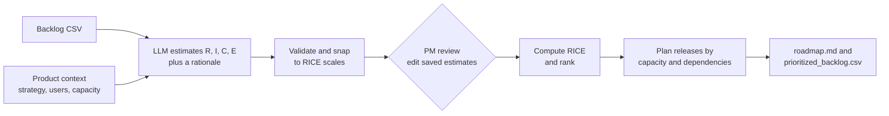

# AI RICE Prioritization Engine

Score a product backlog with RICE using an LLM, then turn the ranking into a capacity-aware release plan, with the PM kept in control of every estimate.

> Rebuilt with a fictional product and synthetic data. It's based on a workflow I built at work that cut my manual RICE assessment and planning time by about 50%. No proprietary code or customer data is included.

## The problem

RICE (Reach × Impact × Confidence ÷ Effort) is a solid way to prioritize, but scoring a large backlog by hand is slow and inconsistent. Estimates drift between sessions, the reasoning behind a score gets lost, and turning a ranked list into a release plan with real capacity limits and dependencies is another manual step.

## How it works



1. **Grounded estimates.** The model gets each item's description and customer signal (tickets, interviews, upvotes) plus the product's strategy and user base, and returns Reach, Impact, Confidence, Effort, and a short rationale.
2. **Guardrails.** Impact and Confidence are snapped to the standard RICE scales, and any adjustment is flagged.
3. **Human in the loop.** Estimates can be saved to JSON, reviewed and edited by the PM, then re-run without calling the model again.
4. **Deterministic math.** Python, not the model, computes scores, ranks items, and places them into releases.
5. **Release planning.** Items fill releases in rank order up to team capacity. A dependency is pulled forward when a higher-ranked item needs it, and nothing ships before what it depends on.
6. **Review queue.** Low-confidence items are listed separately as candidates for discovery before committing.

## Quick start

```bash
pip install -r requirements.txt

# Offline demo with saved estimates (no API key needed)
python rice_engine.py --estimates data/sample_estimates.json

# Live run with Claude
export ANTHROPIC_API_KEY=your-key
python rice_engine.py --save-estimates output/estimates.json

# Edit output/estimates.json, then re-plan using your overrides
python rice_engine.py --estimates output/estimates.json --capacity 8 --releases "Q1,Q2"
```

Run the tests with `python -m unittest discover -s tests`.

## Sample output

From [`output/roadmap.md`](output/roadmap.md), using the fictional FieldFlow backlog:

| Rank | Item | RICE | Effort | Release |
|---|---|---|---|---|
| 1 | One-click quote-to-invoice | 14,000 | 0.5 | R1 |
| 2 | Automated invoice reminders | 9,600 | 1 | R1 |
| 3 | "On my way" SMS notifications | 4,000 | 1 | R1 |
| 6 | QuickBooks Online sync | 1,600 | 4 | R2 |
| 8 | AI quote drafting *(low confidence)* | 1,333 | 3 | R3 |
| 15 | Custom reporting dashboard *(low confidence)* | 188 | 4 | Backlog |

The plan also exposes trade-offs worth discussing. For example, Dark mode lands in R2 because it is small enough to fill leftover capacity, even though it doesn't support this year's strategy. That's the kind of call a PM should make deliberately rather than leave to a formula.

## Design decisions

- **The LLM estimates inputs, not scores.** Keeping the formula and planning in code makes results auditable and repeatable.
- **Rationale is required.** Every score comes with a reason a stakeholder can challenge.
- **Confidence drives discovery.** Low-confidence items are flagged instead of quietly ranked, so they get validated before engineering time is committed.
- **Context over clever prompts.** The model gets the product strategy, user base, and units for Reach and Effort, so its estimates are anchored to the business rather than guessed.

## Limitations and next steps

- Estimates are only as good as the customer signal in the backlog; thin signal means low confidence.
- Ranking is pure RICE. Strategic bets, commitments, and tech debt still need PM judgment.
- Next: strategy-weighted scoring, a Jira or Azure DevOps import, and a simple UI for reviewing and overriding estimates.

## Project structure

```
├── rice_engine.py            # Estimation, validation, scoring, release planning
├── data/
│   ├── backlog.csv           # Fictional backlog (15 items)
│   ├── product_context.md    # Strategy, users, units, capacity
│   └── sample_estimates.json # Illustrative estimates for the offline demo
├── output/                   # Generated roadmap and ranked backlog
└── tests/test_engine.py      # Scoring and planning tests
```

---
Built by [Akshat Atray](https://linkedin.com/in/atray-akshat) · Product Manager, AI-powered workflows
